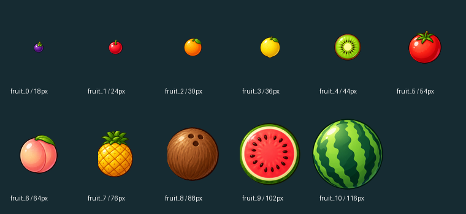

# 瓜瓜坠落 · WatermelonGT5

为华为 GT5 制作的“合成大西瓜”小游戏，适配 466×466 圆形屏幕，使用 HarmonyOS Lite Wearable API12。

作者：**moyu**。当前候选版本 **1.3.0**，应用标识保持 `com.moyu.gt5.watermelon`。项目用于学习和交流，代码和素材分别授权，见下文。



## 功能

- 11 级水果，重力下落、碰撞、堆积和同级合成，最终合成西瓜。
- 点击投放；按住并滑动调整位置，松手投放。
- 显示当前水果、下一颗水果、得分与最高分。
- 开始、暂停、继续、重新开始，失败线带宽限时间。
- 提供 **30 / 60 两种目标更新模式**，默认 30，保存选择。
- 后台暂停循环，保留当前进程内局面；进程结束后不保证恢复局面。
- 内置性能记录、循环异常提示和本应用日志二维码导出。

## 1.3.0 的变化与已知限制

- **减少排序和无效求解**：持久保留水果排序次序，增删时标脏，每遍重新校正；同位置保持确定顺序。只有本遍没有位置、速度、合成或墙修正时才提前结束，最多仍为 4 遍。
- **减少响应式访问**：用纯 JS 投影缓存比较显示变化，避免通过响应式 getter 反复读取旧值，只提交变化字段。
- **固定复用水果图片节点**：使用固定 40 个、运行中不增删的数字 key 直接循环 image，以 show 隐藏空槽，替代原有 40 个 board stack 包装节点；纯 JS 投影缓存继续保留。
- **增加可追踪诊断**：记录 round 开始/重开事件、定时回调频率和时钟粒度；循环异常可见并留日志，便于追查卡死前的状态。调度时钟策略没有改动。

前版已有 SoA 数组、圆碰撞粗筛和全场休眠，这些不计为本版新增。物理仍按 1/60 秒固定步长、每次最多补 6 步、最多 40 颗水果运行；同一步新合成水果不能再次被消费。

**30/60 是目标模式，不是已保证的 GT5 屏幕帧率。**用户报告原版 60 模式空场约 11–12 Hz，五六颗水果时低于 10 Hz，并曾在约 470 分卡死。该卡死尚未复现，物理不是已确认的根因，**新版尚未完成 GT5 真机验证**。此前按活动水果动态增删循环数组的实验候选，在 SDK 原生长测第二局约 143 秒出现 **JS HEAP OOM**，已撤回。当前改为固定 40 槽位复用，固定槽位的 180 秒原生测试已完成，结果以验证记录为准；尚不能保证稳定，也不能把主机计算量下降换算成手表提速。该 SDK OOM 不是原版约 470 分真机卡死的根因证明。

详细源码研究、许可边界和优化计数见 [优化研究](docs/OPTIMIZATION-RESEARCH-1.3.0.md)。

## 素材

水果图来自用户提供的《合成大西瓜素材.zip》，由 512×512 母图裁剪、去除边缘残片并缩放为实际显示尺寸；11 张游戏图为 18–116 像素，启动图标使用西瓜图。母图和来源哈希保存在 `artwork/user-supplied/`，不进入 APP。图片许可独立于代码 MIT，详见下文。

## 工程结构

```text
entry/src/main/config.json              Lite Wearable 配置
entry/src/main/js/default/common/       物理、投影、循环、存储、日志与水果图片
entry/src/main/js/default/pages/        启动入口、游戏与设置界面
entry/src/main/resources/base/media/    启动图标
artwork/user-supplied/                  用户提供的母图和来源记录，不进入 APP
tools/                                 电脑端裁剪、检查和测试工具
docs/                                  研究、构建与验证记录
```

## 构建

使用安装了 Lite Wearable SDK 的 DevEco Studio，或在工程根目录执行：

```powershell
.\build-app.ps1 -DevEcoHome 'E:\DevEco Studio' -SdkHome 'E:\DevEco Studio\sdk'
```

脚本调用 DevEco 自带 Node 与官方 Hvigor 的 `assembleApp`。项目 target / compatible 均为 API12，编译 SDK 以本机实际安装为准。输出：`build/outputs/default/*-unsigned.app`。

图片已经生成，正常构建不需要运行裁剪脚本。重新生成需要 Python 和 Pillow：

```powershell
python -X utf8 tools/prepare-user-assets.py
```

交付为**源码与未签名 APP**，不包含独立 HAP、证书、私钥、调试 Profile 或依赖缓存。签名与安装由使用者在自己的开发环境完成。

## 验证

主机代码测试共 **43 组（35 + 8）**；物理另与原版进行 **24 个种子完整游戏、93,984 步精确状态比较**，均通过。这些覆盖主机逻辑，不代表表端原生内存、刷新性能或 470 分卡死已经验证。

本轮采用 **512 KiB JS 堆设计预算**；当前固件实际可用堆、图片池和峰值尚无本轮 GT5 实测。SDK 构建、受限堆运行、预览和压力测试的当前结果统一见 [验证记录](docs/VALIDATION.md)，不以旧记录代替本版结果。构建成功和电脑预览不能证明手表安装成功或实际性能。

真机复测应覆盖 30/60、空场、5–6 球、连续合成至 470 分附近及以上、满场、暂停/重开/后台返回和最高分保存。出现异常时保留性能记录或日志二维码；循环、回调、页面提交和屏幕呈现分别判断。

## 许可证：代码和图片分别授权

**程序代码：MIT。**允许使用、修改、分享和商业使用，须保留版权与许可声明。MIT 不要求修改者一定公开源码，也不能禁止别人商用代码。完整条文见 [LICENSE](LICENSE)。

**用户提供的水果素材及派生图标：CC BY-NC 4.0。**许可范围内允许署名后进行非商业分享和修改，须标明修改并附许可链接；商业使用不在这份许可范围内。见 [图片许可](LICENSE-ARTWORK.md)。许可仅涵盖许可人依法享有的权利，本工程没有独立核实图片的全部来源权利。

**MIT 不覆盖这些图片。**如果分发包含图片的完整游戏，还须遵守图片许可。GitHub 创建仓库时可为代码选择 MIT，再一同上传本工程的 `LICENSE-ARTWORK.md`、`LICENSING.md` 和 `THIRD_PARTY.md`。如果某个平台要求连图片也必须采用 MIT，这套混合许可不符合该要求；把代码选成 MIT 不会改变图片的许可。

此前已经按 MIT 发布的代码授权继续有效。不能通过一句“仅供学习”收回 MIT 已允许的商业使用。更多范围说明见 [LICENSING.md](LICENSING.md)。

## 致谢

- 用户提供的水果素材及游戏测试反馈。
- [huawei-lite-watch-development](https://github.com/AlanLinYu/huawei-lite-watch-development) 的 Lite Wearable 开发规范。
- 本机 API12 的 2048 参考工程，以及 GitHub 上的嵌入式合成游戏研究资料。
- 应用日志模块沿用工作区的 MIT / moyu 实现。

具体来源、参考范围与第三方声明见 [THIRD_PARTY.md](THIRD_PARTY.md)。
